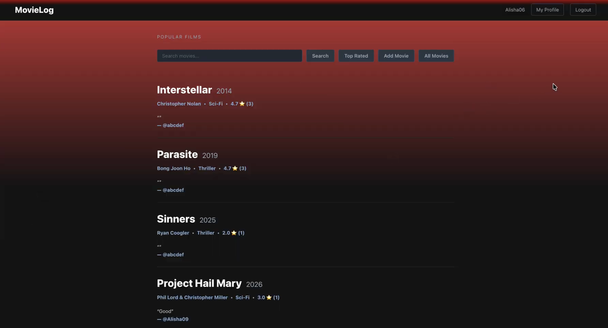
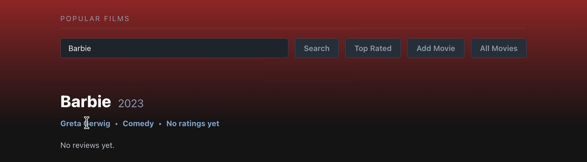
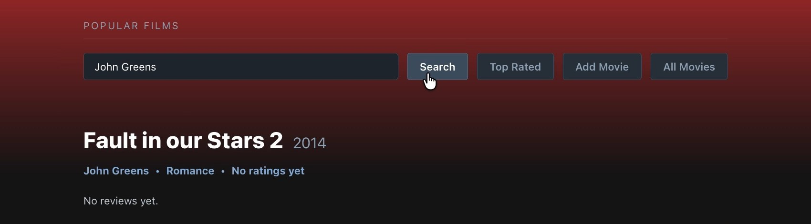
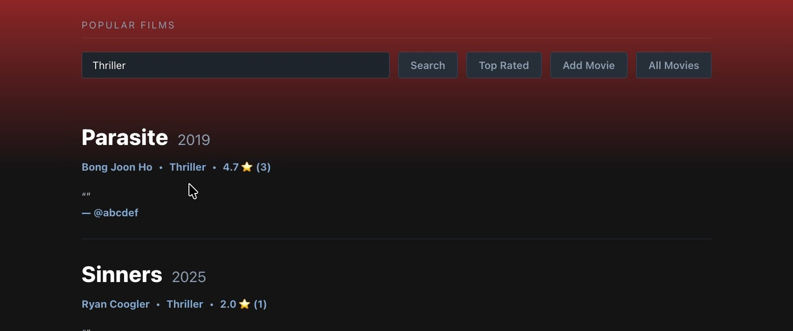
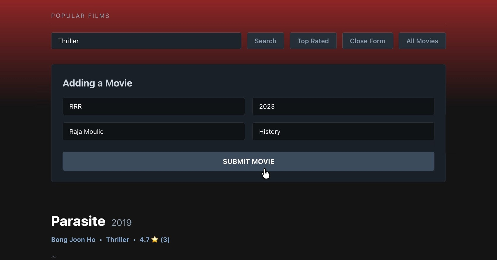
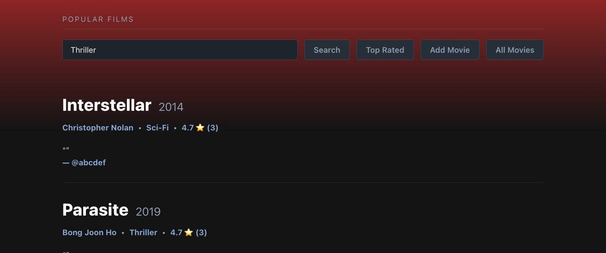
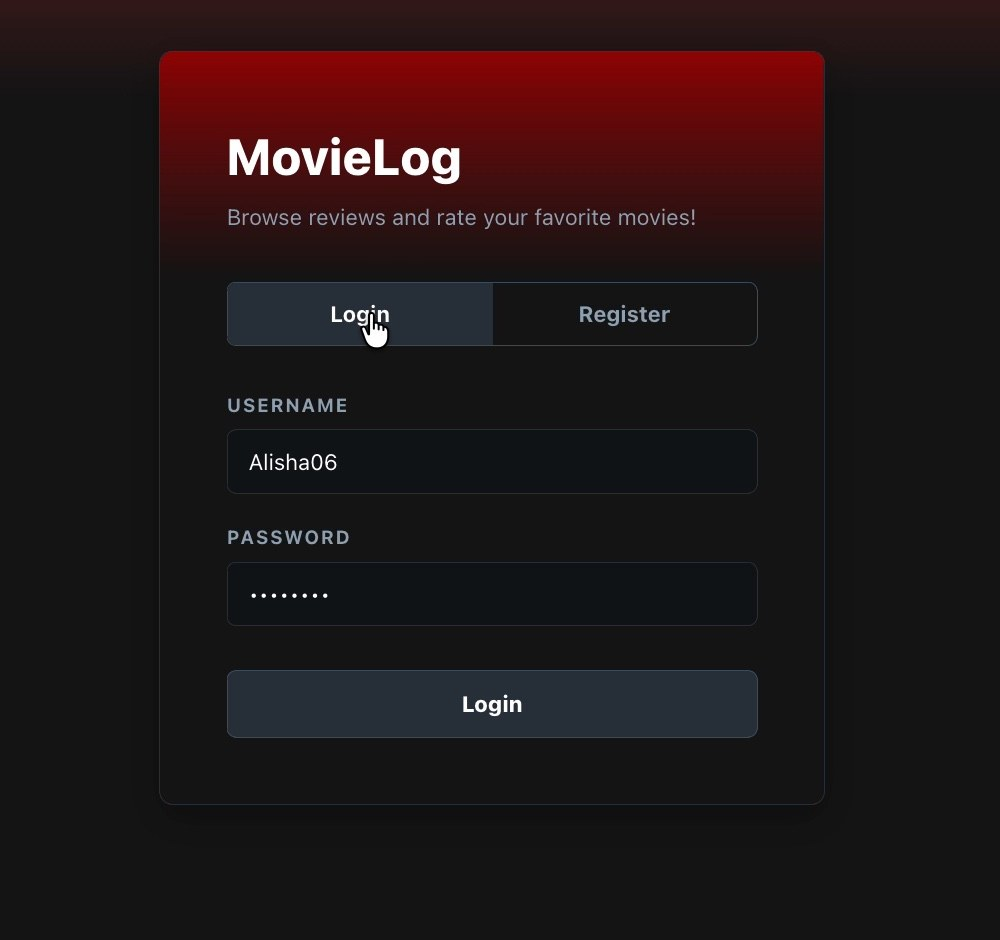
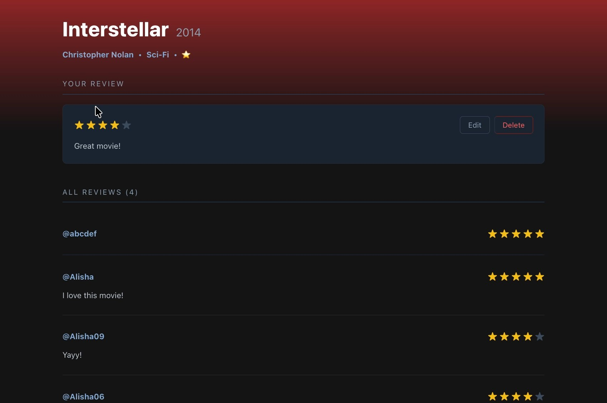
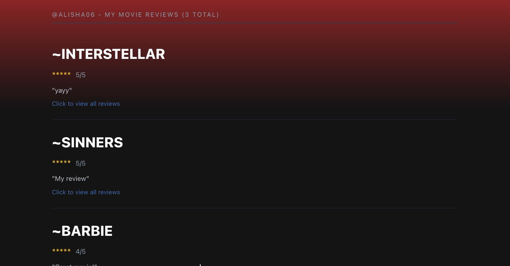

# MovieLog

A full-stack movie review app where people sign in, browse movies, and rate and review them. Built by a team of four as the final project for CSC 413 (Software Development) at San Francisco State University, Spring 2026.

> **About this repository:** The source code is kept in a private course repository. This page is a showcase of the project and my contributions.



## The idea

Finding a movie worth watching usually means bouncing between review sites. MovieLog keeps it in one place: you sign in, search the catalog however you remember a movie (by title, director, year or genre), see what other people thought, and leave your own rating and review.

The team split ownership by feature. Each of us owned specific back-end endpoints and the screens that use them, and we agreed on one API response shape up front so front-end and back-end work could happen in parallel.

## My role: search, add movie and top rated

I owned three features from the API to the interface.

**Back end:** `Movie`, `MovieRequest` and `MovieController`

| Endpoint | What it does |
|---|---|
| `GET /movies/search?q=` | Case-insensitive search across title, director, year and genre. Each result includes the movie's average rating and review count. |
| `POST /movies` | Adds a movie. Turns the title into a URL-friendly ID ("The Dark Knight" becomes `the-dark-knight`) and returns a `400` error if that movie already exists. |
| `GET /movies/top-rated` | Returns movies with at least one review and an average of 4 stars or more. |

**Front end:** on the `/movies` page, the search bar, the add-movie form and the top-rated view.

### Search

One search box covers every field, so people don't have to know which one to use.

<table>
  <tr>
    <td align="center" valign="top" width="33%">
      <br>
      <sub>By title</sub>
    </td>
    <td align="center" valign="top" width="33%">
      <br>
      <sub>By director</sub>
    </td>
    <td align="center" valign="top" width="33%">
      <br>
      <sub>By genre</sub>
    </td>
  </tr>
</table>

### Add a movie and see what's top rated

<table>
  <tr>
    <td align="center" valign="top" width="50%">
      <br>
      <sub>The add-movie form sends a <code>POST /movies</code> request.</sub>
    </td>
    <td align="center" valign="top" width="50%">
      <br>
      <sub>Top Rated keeps only movies averaging 4 stars or more.</sub>
    </td>
  </tr>
</table>

## The rest of the app

My teammates built sign-in, movie details, reviews and profiles.

<table>
  <tr>
    <td align="center" valign="top" width="33%">
      <br>
      <sub>Sign in or register</sub>
    </td>
    <td align="center" valign="top" width="33%">
      <br>
      <sub>Rate, edit and delete reviews</sub>
    </td>
    <td align="center" valign="top" width="33%">
      <br>
      <sub>Profile with review history</sub>
    </td>
  </tr>
</table>

| Teammate | Back end | Front end |
|---|---|---|
| Justin Santos | `Movie`, `MovieResponse`, `MovieController`, `MovieRepository`, `DataInitializer` · `GET /movies`, `GET /movies/{id}` | `/movies` |
| **Emely Sarceno Bravo** | `Movie`, `MovieRequest`, `MovieController` · `POST /movies`, `GET /movies/search`, `GET /movies/top-rated` | `/movies`: search, add movie, top rated |
| Alisha Sinha | `ReviewMovieController` · `GET /movies/{id}/reviews`, `GET /users/{id}/ratings`, `GET /movies/{id}/reviews/count`, `GET /users/{id}/reviews/count` | `/profile`, navigation buttons, app-wide styling |
| Vihaan Shah | `Review`, `ReviewRepository`, `ReviewRequest`, `ReviewController` · `POST /movies/{id}/rate`, `PUT /ratings/{id}`, `DELETE /ratings/{id}` | `/movies/[id]/reviews` |

## How it works

- **One response shape.** Every endpoint returns `{ status, data, error }`, so the front end handles every response the same way.
- **Authentication.** Registering hashes the password with SHA-256 and saves the user to MongoDB. Logging in checks the hash, creates a session token, and sends an auth cookie. Protected routes read that cookie to find the logged-in user.
- **Ratings on the fly.** Search and top rated join each movie with its reviews to calculate an average rating and a review count.
- **API proxy.** The Next.js front end sends requests to `/api/*`, which are forwarded to the Spring Boot server.

## Getting started

**You'll need:** Java 17+, Maven, Node.js 18+, and MongoDB running locally on port 27017.

```bash
# 1. Start the back end (http://localhost:8080)
cd back-end
mvn spring-boot:run

# 2. In a second terminal, start the front end (http://localhost:3000)
cd front-end
npm install
npm run dev
```

Open http://localhost:3000, register an account, and you'll land on the movies page.

## What I learned

- **An API is a contract with your teammates.** Agreeing on one response shape early meant the front end could be built against my endpoints before they were finished.
- **Spot the N+1 query.** Each endpoint looks up reviews movie by movie. That's fine for a class dataset, but at scale I'd calculate averages with a MongoDB aggregation or store them.
- **Plan for duplicate data.** Generating IDs from titles made URLs readable, but it meant designing for duplicates and odd characters from the start.

## Tech stack

Java · Spring Boot · MongoDB · Next.js · React · REST APIs · Maven · Git

## Links

- [Full case study on my portfolio](https://portfolio-emelysarcenobravo.vercel.app/work/movie-reviews)
- [Final demo](https://drive.google.com/drive/folders/1b0n8cVup9IJNTdFqUi8LKOtWu2Fu6lLR?usp=sharing)
